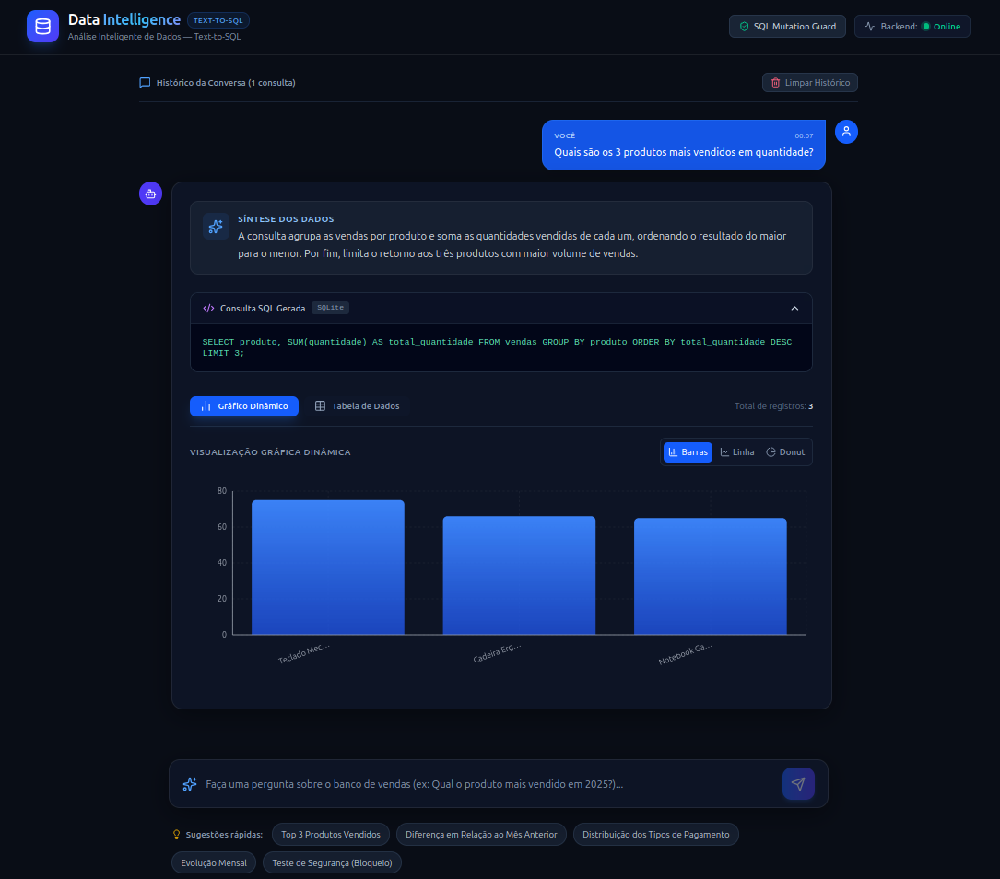
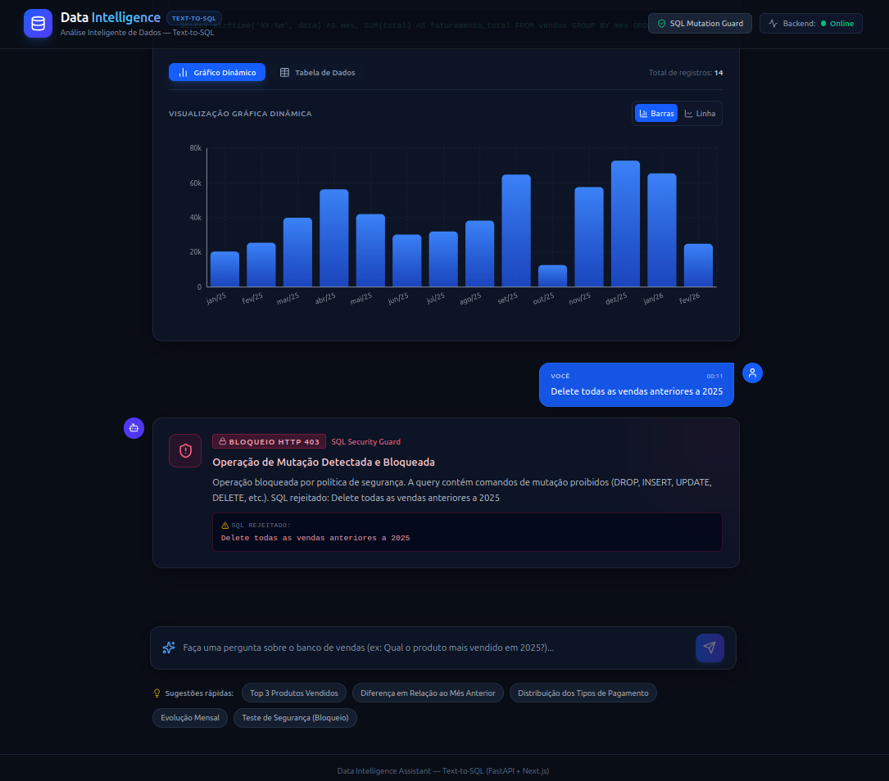
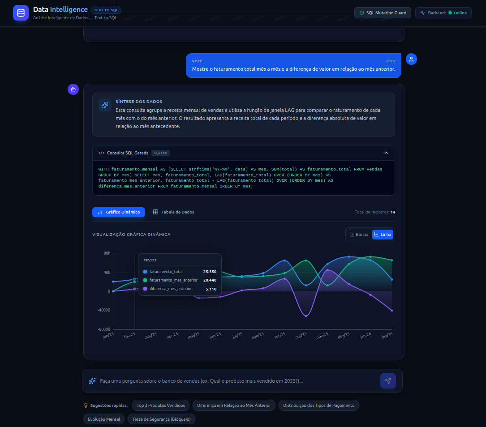
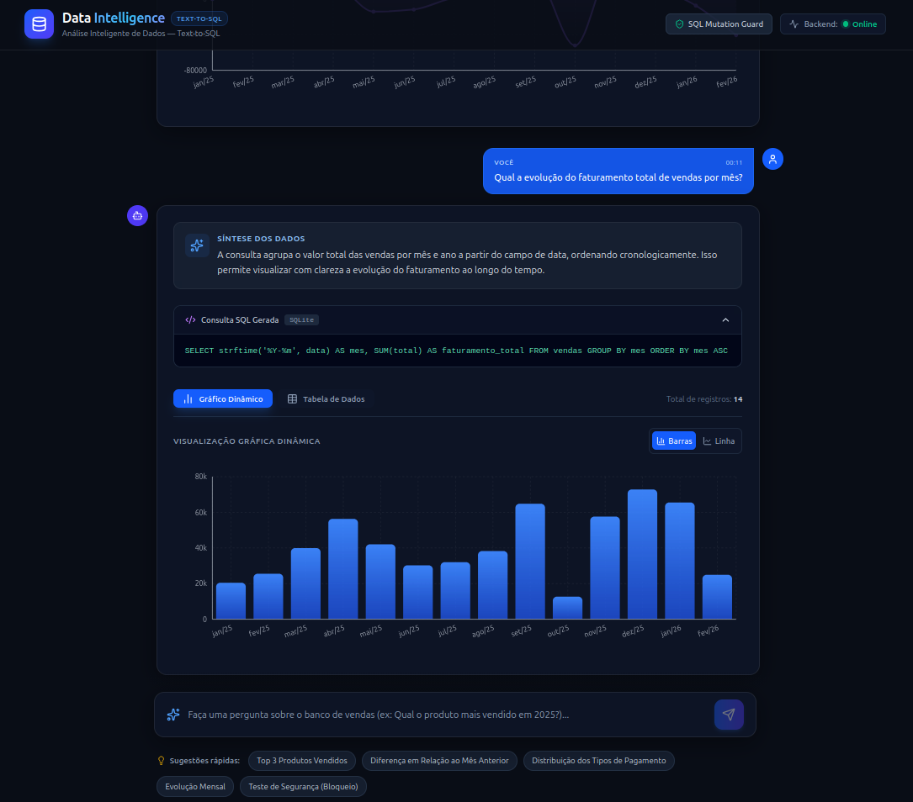
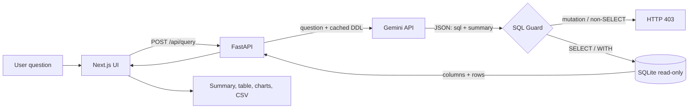

# Text-to-SQL Assistant

[](https://github.com/Douglas-v/text-to-sql-assistant/actions/workflows/ci.yml)


🇧🇷 [Leia em português](README.pt-BR.md)

> Ask questions about sales data in natural language. The LLM writes the SQL, a **security layer validates it**, the database runs it **read-only**, and the UI shows a summary, a paginated table and charts.

## Demo





<details>
<summary>More examples</summary>





</details>

## The engineering problem

Letting an LLM generate SQL that runs against a real database is risky: the model can hallucinate columns, return malformed output or, worse, produce destructive statements (`DROP`, `DELETE`) — by mistake or through a malicious prompt.

This project explores a minimal but defensible answer, in layers:

1. The schema (DDL) is cached at startup and injected into the model's system instruction, so queries use real table/column names.
2. The model must answer in structured JSON (`sql` + `sintese`).
3. A **SQL Guard** (regex) rejects mutations and anything that doesn't start with `SELECT`/`WITH` (HTTP 403).
4. The query runs on a **SQLite connection opened with `mode=ro`**, the real barrier if the guard is ever bypassed.

> **Scope:** a functional prototype over a single synthetic table (`vendas`, 150 generated rows) and a single LLM call. There is no agent orchestration or RAG here. See [limitations and roadmap](docs/roadmap.md).

## Architecture



## Technical decisions

| Component | Choice | Why |
|-----------|--------|-----|
| API | FastAPI + Pydantic v2 | Typed request/response validation and automatic OpenAPI docs |
| LLM | Gemini via official `google-genai` SDK | Native JSON output (`response_mime_type`) and a generous free tier; model is configurable (`GEMINI_MODEL`) |
| Database | SQLite | Zero setup for a reproducible demo; opened read-only for queries |
| Schema context | DDL cached at startup | Avoids reading the database on every request; fits small schemas (see roadmap for RAG) |
| Safety | Regex guard + `mode=ro` | The regex is a fast, explicit, testable first layer; the read-only driver is the hard guarantee |
| Frontend | Next.js 16 (App Router), React 19, Tailwind 4, Recharts | Chat UI with dynamic charts; PT-BR formatting centralized in `lib/formatters.js` |
| Tests | pytest, Gemini mocked | Deterministic, no network and no API key needed (also in CI) |

## Quickstart

Requirements: Python 3.11+, Node.js 18+, a [Gemini API key](https://aistudio.google.com/).

```bash
# 1. Backend (terminal 1)
cd backend
python3 -m venv .venv && source .venv/bin/activate   # Windows: .venv\Scripts\activate
pip install -r requirements.txt
cp .env.example .env          # then set GEMINI_API_KEY
python -m uvicorn app.main:app --reload     # http://localhost:8000  (docs at /docs)

# 2. Frontend (terminal 2)
cd frontend
npm install
npm run dev                   # http://localhost:3000
```

Linux/macOS: use `python3`. On Debian/Ubuntu you may need `sudo apt install python3-venv` first.

The database is created and populated on first startup. Windows users: see [troubleshooting](docs/troubleshooting-windows.md). Docker support is planned.

## Environment variables

| Variable | Where | Required | Default | Description |
|----------|-------|----------|---------|-------------|
| `GEMINI_API_KEY` | `backend/.env` | yes | — | Gemini API key |
| `GEMINI_MODEL` | `backend/.env` | no | `gemini-3.5-flash` | Gemini model name |
| `CORS_ORIGINS` | `backend/.env` | no | `http://localhost:3000,http://127.0.0.1:3000` | Allowed origins, comma-separated |
| `DB_PATH` | `backend/.env` | no | `backend/vendas_ficticias.db` | SQLite file path |
| `NEXT_PUBLIC_API_URL` | `frontend/.env.local` | no | `http://localhost:8000` | Backend base URL |

## Tests

```bash
cd backend
pip install -r requirements-dev.txt
pytest
```

Covers the SQL Guard (allowed and blocked statements), the read-only connection, multi-statement rejection and the API endpoints (Gemini mocked).

## Repository layout

```
backend/
  app/
    main.py              # FastAPI app, CORS, lifespan (DDL cache), endpoints
    services/gemini.py   # prompt, Gemini call and SQL Guard
    db/database.py       # idempotent data generation, DDL extraction, read-only execution
  tests/                 # pytest suite
frontend/                # Next.js app (chat, table, charts, CSV export)
docs/                    # API reference, roadmap, Windows troubleshooting
```

More: [API reference](docs/api.md) · [Roadmap](docs/roadmap.md)

## Authorship and scope

Built as a hands-on technical challenge and kept as a portfolio project. The code is my own work, developed with AI assistance (Claude) as a pair-programming tool. The data is entirely synthetic.

## License

[MIT](LICENSE)
