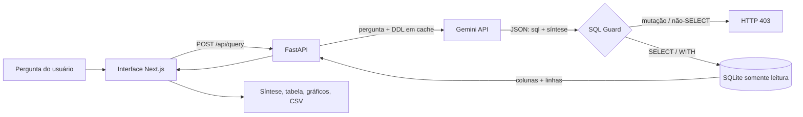

# Text-to-SQL Assistant

[](https://github.com/Douglas-v/text-to-sql-assistant/actions/workflows/ci.yml)


🇺🇸 [Read in English](README.md)

> Faça perguntas sobre dados de vendas em linguagem natural. O LLM escreve o SQL, uma **camada de segurança o valida**, o banco o executa em **modo somente leitura** e a interface exibe síntese, tabela paginada e gráficos.

## O problema de engenharia

Deixar um LLM gerar SQL que roda em um banco real é arriscado: o modelo pode inventar colunas, devolver uma saída malformada ou, pior, gerar comandos destrutivos (`DROP`, `DELETE`), por erro ou por um prompt malicioso.

Este projeto explora uma resposta mínima, porém defensável, em camadas:

1. O schema (DDL) é cacheado no startup e injetado na instrução de sistema, para que as queries usem nomes reais de tabelas e colunas.
2. O modelo deve responder em JSON estruturado (`sql` + `sintese`).
3. Um **SQL Guard** (regex) rejeita mutações e qualquer coisa que não comece com `SELECT`/`WITH` (HTTP 403).
4. A query roda em uma **conexão SQLite aberta com `mode=ro`**, a barreira real caso o guard seja contornado.

> **Escopo:** protótipo funcional sobre uma única tabela sintética (`vendas`, 150 linhas geradas) e uma única chamada ao LLM. Não há orquestração de agentes nem RAG. Veja [limitações e roadmap](docs/roadmap.md).

## Arquitetura



## Decisões técnicas

| Componente | Escolha | Por quê |
|-----------|---------|---------|
| API | FastAPI + Pydantic v2 | Validação tipada de entrada/saída e OpenAPI automático |
| LLM | Gemini via SDK oficial `google-genai` | Saída JSON nativa (`response_mime_type`) e camada gratuita; modelo configurável (`GEMINI_MODEL`) |
| Banco | SQLite | Zero configuração para uma demo reproduzível; aberto em modo somente leitura nas consultas |
| Contexto do schema | DDL em cache no startup | Evita ler o banco a cada requisição; adequado a schemas pequenos (RAG no roadmap) |
| Segurança | Guard por regex + `mode=ro` | O regex é uma primeira camada rápida, explícita e testável; o driver somente leitura é a garantia forte |
| Frontend | Next.js 16 (App Router), React 19, Tailwind 4, Recharts | Chat com gráficos dinâmicos; formatação PT-BR centralizada em `lib/formatters.js` |
| Testes | pytest, Gemini mockado | Determinísticos, sem rede nem chave de API (também no CI) |

## Como executar

Requisitos: Python 3.11+, Node.js 18+ e uma [chave da Gemini API](https://aistudio.google.com/).

```bash
# 1. Backend (terminal 1)
cd backend
pip install -r requirements.txt
cp .env.example .env          # depois defina GEMINI_API_KEY
python -m uvicorn app.main:app --reload     # http://localhost:8000  (docs em /docs)

# 2. Frontend (terminal 2)
cd frontend
npm install
npm run dev                   # http://localhost:3000
```

O banco é criado e populado na primeira inicialização. Usuários de Windows: veja a [solução de problemas](docs/troubleshooting-windows.md). Suporte a Docker está planejado.

## Variáveis de ambiente

| Variável | Onde | Obrigatória | Padrão | Descrição |
|----------|------|-------------|--------|-----------|
| `GEMINI_API_KEY` | `backend/.env` | sim | — | Chave da Gemini API |
| `GEMINI_MODEL` | `backend/.env` | não | `gemini-3.5-flash` | Nome do modelo Gemini |
| `CORS_ORIGINS` | `backend/.env` | não | `http://localhost:3000,http://127.0.0.1:3000` | Origens permitidas, separadas por vírgula |
| `DB_PATH` | `backend/.env` | não | `backend/vendas_ficticias.db` | Caminho do arquivo SQLite |
| `NEXT_PUBLIC_API_URL` | `frontend/.env.local` | não | `http://localhost:8000` | URL base do backend |

## Testes

```bash
cd backend
pip install -r requirements-dev.txt
pytest
```

Cobre o SQL Guard (comandos permitidos e bloqueados), a conexão somente leitura, a rejeição de múltiplos statements e os endpoints (Gemini mockado).

## Estrutura do repositório

```
backend/
  app/
    main.py              # App FastAPI, CORS, lifespan (cache do DDL), endpoints
    services/gemini.py   # prompt, chamada ao Gemini e SQL Guard
    db/database.py       # geração idempotente de dados, extração do DDL, execução somente leitura
  tests/                 # suíte pytest
frontend/                # App Next.js (chat, tabela, gráficos, exportação CSV)
docs/                    # referência da API, roadmap, troubleshooting no Windows
```

Mais: [Referência da API](docs/api.md) · [Roadmap](docs/roadmap.md)

## Autoria e escopo

Construído como desafio técnico prático e mantido como projeto de portfólio. O código é de minha autoria, desenvolvido com assistência de IA (Claude) como ferramenta de pair programming. Os dados são totalmente sintéticos.

## Licença

[MIT](LICENSE)
